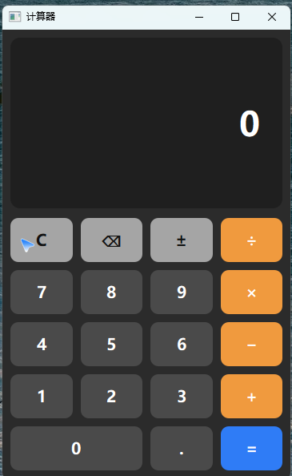

# Qt 实验一：带键盘事件的计算器

使用 Qt 6 Widgets 实现的计算器，支持**鼠标点击**和**键盘输入**两种操作方式，两者共用同一套处理逻辑。



## 功能

- 四则运算（+ − × ÷）、小数输入、负数结果
- 退格 `⌫`、清除 `C`、正负号切换 `±`
- 连续运算：算出结果后可直接按运算符继续计算
- 键盘输入：数字、运算符、等号/回车、小数点、退格、`C`/`Esc`，兼容主键盘与小键盘
- 边界处理：除数为 0、重复小数点、连续运算符、计算完成后继续输入、超长输入

## 目录结构

| 文件 | 说明 |
|---|---|
| `labones.pro` | qmake 工程文件（Qt 6，C++17） |
| `main.cpp` | 程序入口 |
| `mainwindow.h` | 主窗口类声明：计算状态与槽函数 |
| `mainwindow.cpp` | 界面连接、运算逻辑、键盘事件、样式表 |
| `mainwindow.ui` | Qt Designer 界面文件（显示屏 + 4×5 按键网格） |
| `.gitignore` | 忽略编译产物与 Qt Creator 自动生成文件 |

## 编译运行

### 方式一：Qt Creator（推荐）

1. 用 Qt Creator 打开 `labones.pro`
2. 选择 **Desktop Qt 6.x MinGW 64-bit** 套件
3. 按 `Ctrl + R` 运行

### 方式二：命令行

```powershell
qmake labones.pro -spec win32-g++
mingw32-make -j8
```

生成的程序位于 `release/labones.exe`（Debug 构建在 `debug/` 下）。

> 命令行编译前需把 Qt 的 `bin` 目录和 MinGW 的 `bin` 目录加入 `PATH`，否则会提示找不到编译器或缺少 Qt DLL。

## 键盘操作

| 按键 | 功能 |
|---|---|
| `0` ~ `9` | 输入数字（含小键盘） |
| `+` `-` `*` `/` | 加、减、乘、除 |
| `=` 或 `Enter` | 计算结果 |
| `.` 或 `,` | 小数点 |
| `Backspace` | 退格 |
| `C` 或 `Esc` | 清除 |

## 实现要点

- **状态机**：用 5 个成员变量（当前输入串、第一个操作数、待执行运算符、是否等待第二个操作数、是否刚算完）描述计算过程，所有按键只负责修改状态，显示统一由 `updateDisplay()` 刷新。
- **一套逻辑两种输入**：`keyPressEvent()` 只做“按键 → 动作”的映射，随后调用与鼠标点击完全相同的槽函数，因此两种输入方式行为一致。
- **异常输入**：除数为 0 用 `qFuzzyIsNull()` 拦截并提示；小数点通过 `contains('.')` 去重；连续运算符按“替换”语义处理。

## 实验信息

- 课程：Qt 应用程序开发
- 实验：实验一 · 带键盘事件的计算器
- 运行环境：Qt 6.11.2 / MinGW 13.1.0 64-bit / Windows 11
